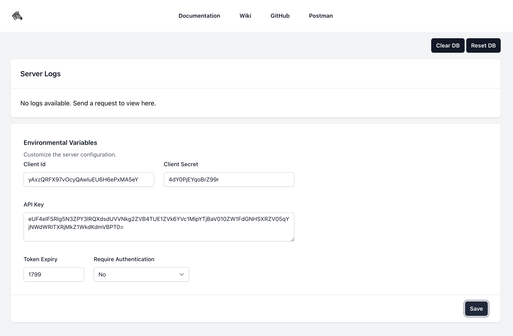

# Investec Programmable Banking Stateful Sandbox

A Node.js server to get everyone building and demoing regardless whether you have an account. The sandbox is set up in a way that it provides a single profile. Under the profile you are able to see accounts and cards. It does not require authentication because of the single profile. 

There is a number of control functions, such as creating an account or adding transactions. These features help set up the environment you need for your scenario.


[](https://github.com/devinpearson/programmable-banking-sim/pulls)



## Table of Contents
- [Installation](#installation)
- [Docker](#docker)
- [Usage](#usage)
- [Endpoints](#endpoints)
- [Contributing](#contributing)
- [License](#license)

## Installation
Before installing, [download and install Node.js](https://nodejs.org/en/download/).

```bash
git clone https://github.com/devinpearson/programmable-banking-sim.git
cd programmable-banking-sim
```
```bash
npm install
npm run web:install
```

The sandbox has two parts:
- **The API** (`src/`): Express + Prisma (SQLite), emulating the Investec APIs on http://localhost:3000.
- **The web app** (`web/`): Next.js 15, React 19, Tailwind CSS v4 and SWR. It holds the dashboard and the simulated bank's OAuth login and consent pages, on http://localhost:3001.

## Docker
To run both in a Docker container, run the following
```bash
docker build -t investec-sim .
docker run -p 3000:3000 -p 3001:3001 investec-sim
```
For a hosted deploy, build with the API's public URL so the browser can reach it: `--build-arg NEXT_PUBLIC_API_BASE_URL=https://your-api-host`, and set `WEB_URL` on the container to the web app's public URL.

## Usage
To start the simulator, run the following
```bash
npm run dev
```

[](https://god.gw.postman.com/run-collection/26868804-62ce3cf6-3d98-4f62-ad82-b912b9826d51?action=collection%2Ffork&source=rip_markdown&collection-url=entityId%3D26868804-62ce3cf6-3d98-4f62-ad82-b912b9826d51%26entityType%3Dcollection%26workspaceId%3D37bb2e58-4709-4bd4-8b2c-b00fe7445371#?env%5BSim%5D=W3sia2V5IjoiY2FyZGtleSIsInZhbHVlIjoiIiwidHlwZSI6InNlY3JldCIsImVuYWJsZWQiOnRydWV9LHsia2V5IjoiYWNjb3VudElkIiwidmFsdWUiOiI0Njc1Nzc4MTI5OTEwMTg5NjAwMDAwMDAzIiwidHlwZSI6ImRlZmF1bHQiLCJlbmFibGVkIjp0cnVlfSx7ImtleSI6ImJlbmVmaWNpYXJ5SWQiLCJ2YWx1ZSI6Ik1UQXhPVEEyT1RJNU56MzBNak09IiwidHlwZSI6ImRlZmF1bHQiLCJlbmFibGVkIjp0cnVlfSx7ImtleSI6ImNsaWVudF9pZCIsInZhbHVlIjoiIiwidHlwZSI6InNlY3JldCIsImVuYWJsZWQiOnRydWV9LHsia2V5IjoiY2xpZW50X3NlY3JldCIsInZhbHVlIjoiIiwidHlwZSI6InNlY3JldCIsImVuYWJsZWQiOnRydWV9LHsia2V5IjoiYXBpX2tleSIsInZhbHVlIjoiIiwidHlwZSI6InNlY3JldCIsImVuYWJsZWQiOnRydWV9LHsia2V5IjoidG9rZW4iLCJ2YWx1ZSI6IiIsInR5cGUiOiJkZWZhdWx0IiwiZW5hYmxlZCI6dHJ1ZX0seyJrZXkiOiJob3N0IiwidmFsdWUiOiJsb2NhbGhvc3Q6MzAwMCIsInR5cGUiOiJkZWZhdWx0IiwiZW5hYmxlZCI6dHJ1ZX1d)

This starts the API on http://localhost:3000 and the dashboard on http://localhost:3001. Run just one with `npm run dev:api` or `npm run dev:web`.

The dashboard lets you load scenarios, top up accounts and transfer between them, browse each account's transaction history (by period and type, with pending holds), pay beneficiaries, add cards to accounts, swipe them in any currency and settle or reverse the pending holds they create, stop and reactivate cards, watch the API's request log live, and change the sandbox's settings. It refreshes itself whenever the API's data changes, including changes made from Postman. It also edits exchange rates, manages webhooks and fault injection, and exports or imports the whole sandbox. With "Require authentication" on, the dashboard gets its own token through the client-credentials flow.

### Saving and sharing a setup
**Export** on the dashboard (or `GET /export`) downloads the sandbox's data as JSON: profiles, accounts, transactions, beneficiaries, cards with their code, and exchange rates. Settings, fault settings and webhooks are left out. **Import** (or `POST /import`) validates a file and replaces the data with it, all or nothing, so a team can share a reproducible setup.

The web app reads the API's address from `NEXT_PUBLIC_API_BASE_URL` (default `http://localhost:3000`), and the API sends OAuth users to the web app at `WEB_URL` (default `http://localhost:3001`).

### Web app development
In `web/`: `npm run lint`, `npm run typecheck`, `npm run test:unit` (Vitest), `npm run test:e2e` (Playwright, which starts its own API and web app on spare ports with a throwaway database) and `npm run build`.

The web app's API types (`web/lib/api/schema.d.ts`) are generated from the OpenAPI document: after changing the API, run `npm run openapi:generate` in the root, then `npm run api:types` in `web/`. CI fails if either is stale.

There are helpful links to the Investec docs, Community wiki, GitHub repo and the Postman collection.

## API docs
The OpenAPI document is generated from the same zod schemas that validate requests, so the docs and the API can't drift apart.
- **Swagger UI:** http://localhost:3000/swagger-ui (or `/api-docs`)
- **Spec:** `/api-docs.json` and `/api-docs.yaml`, also committed as [`openapi/openapi.json`](openapi/openapi.json) and [`openapi/openapi.yaml`](openapi/openapi.yaml)
- Operations marked `x-sandbox-only` have no Investec equivalent.

After changing a route or schema, run `npm run openapi:generate`. `npm run openapi:check` (run in CI) fails if a mounted route is undocumented, a documented route isn't mounted, or the files in `openapi/` are stale.

### Validation errors
Invalid requests get a `400` naming the field, plus every problem in `details`:
```json
{
  "errorMessage": "transferList.0.amount: must be greater than zero",
  "details": [{ "location": "body", "path": "transferList.0.amount", "message": "must be greater than zero" }]
}
```
Investec endpoints ignore unknown fields; the sandbox-only endpoints that create records reject them.

## Endpoints

### Dashboard
- **GET /**, **/login**, **/guide**, **/wpaas/prog-banking-wpaas/oauth-consent**
    - Redirect to the same page in the web app (`WEB_URL`), keeping the query string
- **GET /health**
    - Health check endpoint returning service status
### Auth
- **POST /identity/v2/oauth2/token**
    - Get an access token (only required if auth is turned on)
- **GET /identity/v2/oauth2/authorize?client_id=…&redirect_uri=…&scope=…&state=…**
    - Start the 3-legged flow. `redirect_uri` is required. `scope` is space-separated; leave it out to request every scope. `state` is echoed back on the redirect

Sign-in (`POST /login`) and everything under `/identity` are rate limited to `AUTH_RATE_LIMIT` requests per minute per IP (default 300). Over the limit they answer `429` with a `Retry-After` header. The banking endpoints are not limited.

#### 3-legged consent and scopes
When auth is turned on, a token from the 3-legged (`authorization_code`) flow only reaches what the user approved:
- **Accounts:** only the accounts ticked on the consent page (no selection means all accounts). Other accounts, and cards on them, return `403`, and they are left out of the account and card lists.
- **Scopes:** each route needs a scope; a missing one returns `403 { "errorMessage": "Token is missing scope: …" }`.

| Scope | Unlocks |
| --- | --- |
| `accounts` | `GET /za/pb/v1/accounts`, `GET /za/pb/v1/profiles…` |
| `balances` | `GET …/accounts/:accountId/balance` |
| `transactions` | `GET …/transactions`, `GET …/pending-transactions` |
| `transfers` | `POST …/transfermultiple` |
| `beneficiarypayments` | `POST …/paymultiple`, `GET …/beneficiaries`, `GET …/beneficiarycategories` |
| `statements` | `GET …/documents` (filter with `fromDate` / `toDate`) |
| `cards` | everything under `/za/v1/cards` |

Refreshed tokens keep the original scope and accounts. `client_credentials` tokens are not limited. These scope names are the sandbox's own; Investec's exact scope strings may differ.

### Accounts
- **GET /za/pb/v1/accounts**
    - Get all accounts
- **GET /za/pb/v1/profiles** and **GET /za/pb/v1/profiles/:profileId/accounts**
    - List profiles (the first is the default) and a profile's accounts. Investec doesn't publish these responses, so the fields are the sandbox's best match
- **GET /za/pb/v1/accounts/:accountId/balance**
    - Get the balance of an account. `currentBalance` counts posted transactions; `availableBalance` adds the account's overdraft limit and subtracts pending card holds
- **GET /za/pb/v1/accounts/:accountId/transactions**
    - Get the transactions of an account, newest first. `runningBalance` and `postedOrder` follow posting date, so backdated inserts land in the right place. Add `?includePending=true` to include pending card holds (listed on top)
- **GET /za/pb/v1/accounts/:accountId/pending-transactions**
    - Get the pending (unsettled) transactions of an account
- **POST /za/pb/v1/accounts/:accountId/transfermultiple** / **paymultiple**
    - Transfer or pay. Responds like Investec: `{ "data": { "TransferResponses": [{ "PaymentReferenceNumber", "PaymentDate", "Status", "BeneficiaryName", "BeneficiaryAccountId", "AuthorisationRequired" }], "ErrorMessage": null } }`, one entry per transfer or payment. A batch that exceeds the available balance is rejected with `422` and `{ "errorMessage": "Insufficient funds" }`. Transfers are labelled `OnlineBankingTransfers` and payments `OnlineBankingPayments`; a payment updates the beneficiary's `lastPaymentAmount` and `lastPaymentDate`
- **GET /za/pb/v1/accounts/beneficiaries**
    - Get all beneficiaries

### Cards
- **GET /za/v1/cards/countries**
    - Get all countries
- **GET /za/v1/cards/currencies**
    - Get all currencies
- **GET /za/v1/cards/merchants**
    - Get all merchant types
- **GET /za/v1/cards**
    - Get all cards
- **GET /za/v1/cards/:cardKey/code**
    - Get the saved code of a card
- **POST /za/v1/cards/:cardKey/code**
    - Set the saved code of a card
- **GET /za/v1/cards/:cardKey/publishedcode**
    - Get the published code of a card
- **POST /za/v1/cards/:cardKey/publishedcode**
    - Set the published code of a card
- **POST /za/v1/cards/:cardKey/code/execute**
    - Execute code you supply. This simulates the card executing the code
- **GET /za/v1/cards/:cardKey/code/executions**
    - Get all code executions
- **GET /za/v1/cards/:cardKey/environmentvariables**
    - Get all environment variables
- **POST /za/v1/cards/:cardKey/environmentvariables**
    - Set new environment variables
- **POST /za/v1/cards/:cardKey/toggle-programmable-feature**
    - Toggle the programmable feature of a card

### Foreign currency swipes
A card swipe (`execute-live`) can be in any currency that has an exchange rate. The card code sees the purchase in its own currency (`currencyCode`, `centsAmount`), as on a real card; the account is charged in rand at the sandbox rate, and the hold reads e.g. `London Books (USD 12.50)`. The response's `exchange` field shows the conversion. A currency without a rate gets `422`.

The seed has illustrative (not live) rates for the 22 seeded currencies. Manage them with:
- **GET /exchange-rates**: list the rates
- **PUT /exchange-rates/:currencyCode** `{ "zarPerUnit": 17.6 }`: add a currency or change its rate
- **DELETE /exchange-rates/:currencyCode**: remove one

### Fault injection
Make the bank misbehave on purpose to test your app's error handling, retries and timeouts. Faults apply to the emulated Investec API (`/za/...`) and the token endpoint, never to the sandbox's own controls.

**Per request** (deterministic, good for tests): send a header with any `/za` or token request.

| Header | Effect |
| --- | --- |
| `X-Sandbox-Fault: 429` / `500` / `502` / `503` / `504` | That error, with `{ "errorMessage": "Simulated fault: …" }` (429 adds `Retry-After: 1`) |
| `X-Sandbox-Fault: timeout` (or `timeout:2000`) | No response; the connection drops after 30 s (or the given ms) |
| `X-Sandbox-Fault: reset` | The connection drops immediately |
| `X-Sandbox-Latency: 1500` | The response is delayed by that many ms |

**At random** (good for exploring): set rates from the dashboard's Fault injection panel or `PUT /faults` with `{ "errorRate": 20, "errorStatus": 503, "timeoutRate": 5, "latencyMs": 500, "pathPrefix": "/za/v1/cards" }`. Fields left out are off; `DELETE /faults` turns everything off. Settings survive a restart, and the dashboard shows a banner while they're on.

Faulted responses carry `X-Sandbox-Fault-Injected` and appear in the live server log. The dashboard's own requests (`X-Sandbox-Client: dashboard`) are exempt from random faults, so it keeps working while your app sees errors.

### Webhooks
Register a URL and the sandbox POSTs events to it as they happen, so you can build and test an integration that reacts to the bank (the dashboard has a Webhooks panel too):

| Event | When |
| --- | --- |
| `transaction.posted` | A transaction posts: top-ups, transfer and payment legs, posted swipes, created transactions, and holds that settle |
| `transaction.pending` | A card hold is placed |
| `transaction.reversed` | A hold is reversed |
| `card.authorization` | Every live card swipe, approved or declined (with the reason, merchant and any currency conversion) |
| `webhook.test` | Sent on demand by `POST /webhooks/:webhookId/test` |

Each delivery is a JSON POST, `{ "id", "event", "createdAt", "data" }`, with `X-Sandbox-Event` and `X-Sandbox-Delivery` headers. Give the webhook a `secret` and deliveries also carry `X-Sandbox-Signature: sha256=<HMAC-SHA256 of the raw body, hex>` to verify. Any 2xx response counts as delivered. A failed delivery is retried after 5 s, 30 s and 2 min (set `WEBHOOK_RETRY_DELAYS_MS`, e.g. `1000,5000`, or `""` for none); every attempt carries the same `X-Sandbox-Delivery` id plus `X-Sandbox-Attempt`, so receivers can de-duplicate, and is logged with its status or error. Pausing or deleting the webhook stops the retries. The payload shapes are in the OpenAPI document's `webhooks` section.

- **GET /webhooks**, **POST /webhooks** `{ "url", "events"?, "secret"? }` (no `events` means all)
- **PATCH /webhooks/:webhookId** `{ "active": false }` to pause, or change `url`/`events`
- **DELETE /webhooks/:webhookId**
- **POST /webhooks/:webhookId/test**, **GET /webhooks/:webhookId/deliveries**, **GET /webhooks/events**

Webhooks are configuration: **Reset data** and scenarios leave them in place.

### Mock API only endpoints
- **POST /za/pb/v1/accounts/:accountId/transactions**
    - Creates and inserts a transaction into the history. Only card transactions (`CardPurchases`, `CardWithdrawals`) can be created with `status: "PENDING"`; other types get a `400` unless you add `?allowNonCardPending=true` for the rare non-card pending case. Card transactions can also be inserted already posted: omit `status` or send `"POSTED"`. A pending transaction with no `transactionType` defaults to `CardPurchases`
- **DELETE /za/pb/v1/accounts/:accountId/transactions/2023-01-22**
    - Deletes transactions from account for a particular postingDate
- **POST /za/pb/v1/accounts**
    - Create a new account. Pass `overdraftLimit` to let it go below zero (default `0`)
- **POST /za/pb/v1/accounts/:accountId/pending-transactions/:transactionId/settle**
    - Settle a pending card hold so it posts to the current balance
- **POST /za/pb/v1/accounts/:accountId/transactions/settle**
    - Settle all of an account's pending transactions at once
- **DELETE /za/pb/v1/accounts/:accountId/pending-transactions/:transactionId**
    - Reverse a pending card hold, releasing the funds
- **DELETE /za/pb/v1/accounts/:accountId**
    - Deletes the account and its transactions
- **POST /za/pb/v1/accounts/beneficiaries**
    - Create a new beneficiary
- **DELETE /za/pb/v1/accounts/beneficiaries/:beneficiaryId**
    - Delete a beneficiary
- **POST /za/v1/cards**
    - Issue a card. With `accountId` (which must exist) the card swipes against that account and takes its account number. Defaults: a masked card number like `402167XXXXXX1234`, status `Active`, and the starter code saved and published
- **POST /za/v1/cards/:cardKey/status**
    - Stop or reactivate a card: `{ "status": "Stopped" }` or `{ "status": "Active" }`. Swipes on a stopped card are declined with `reason: "card_not_active"`
- **POST /scenarios/:id**
    - Load a named starting state. It replaces accounts, transactions, beneficiaries and cards; each scenario issues a programmable card on its main account
- **POST /za/v1/cards/:cardKey/code/execute-live**
    - Used for the POS to execute the code on the card. If the card's `accountId` is a real account, the swipe is declined (`reason: "insufficient_funds"`) when the available balance can't cover it, and an approved swipe places a pending `CardPurchases` hold on the account (returned as `transaction`). Send `"settle": true` to post the purchase immediately instead of holding it

Programmable documentation can be found here: https://developer.investec.com/programmable-banking/

[](https://cloud.digitalocean.com/apps/new?repo=https://github.com/devinpearson/programmable-banking-sim/tree/update-dockerfile)

## Contributing

Contributions are welcome! Please submit a pull request or open an issue for any suggestions or improvements.

## License

This project is licensed under the MIT License. See the [LICENSE](LICENSE) file for details.